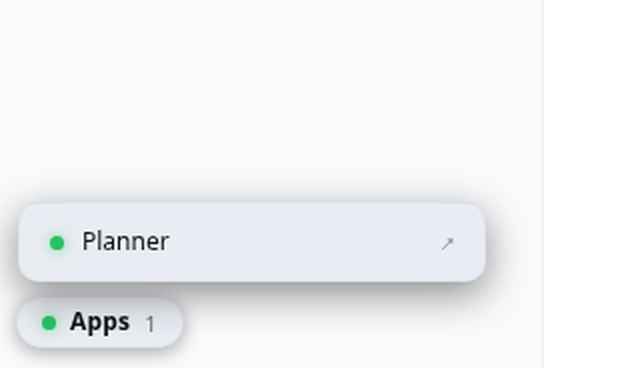

# dsh-app-launcher

A draggable **Apps** pill in the DeepSeek Harness shell. Click it, click an app, and your
host-rendered plugin page opens in **its own OS window** — which you can drag to a second screen,
size, and leave there. A dot beside each app shows whether it is answering right now.

Built for [DeepSeek Harness](https://github.com/deepseek-ai/deepseek-harness) `0.1.1-rc.2`.

<picture>
  <source media="(prefers-color-scheme: dark)" srcset="docs/launcher-dark.png">
  
</picture>

## Why this exists

A host-rendered DSH page has no way in except a URL. That is fine until it isn't:

- **the tab you kept open dies with the machine.** A plugin page served on a local port is not there
  after a reboot, and a bookmark that points at nothing looks exactly like a broken plugin;
- **the harness gives you no sign either way.** There is no dock, no badge, no status — you find out by
  clicking and waiting;
- **"drag it to a second screen" is a manual ritual**, repeated every session, for every page.

This pill is the missing front door: the pages are one click away, and a page that is not answering
says so before you click it.

## Install

```bash
DEST="$HOME/.dsh/profiles/web/node_modules/dsh-app-launcher"
mkdir -p "$DEST"
cp -r lib package.json "$DEST"/
```

```yaml
# ~/.dsh/profiles/web/cordis.patch.yml  (append)
- insert:
    - id: app-launcher
      name: 'dsh-app-launcher'
      config:
        apps:
          - label: Planner
            url: /daily-progress-tab/ui
          - label: Cost panel
            url: http://127.0.0.1:3080/cost-bubble/panel
```

Then restart the harness. The pill appears bottom-left; nothing appears at all until you configure at
least one app.

**Do NOT use `dsh plugin add`** — running a package manager inside a profile materialises a second
`@deepseek-ai/dsh-*` tree and every tool call dies with `Cannot read properties of undefined (reading
'prepare')`. Copy the files in as real files and register the row. The full story, with the recovery:
[How `dsh plugin add` bricked my profile](https://github.com/samorachumbi/dsh-plugin-install-guide).

## Configuration

| field | what it is |
|---|---|
| `apps[].label` | what the row says. Keep it short; it is also the window's name, so **reuse one label per app** |
| `apps[].url` | either a path on the harness origin (`/my-page/ui`) or an absolute `http(s)` URL for a page on another local port |

Rules the host enforces before anything reaches the browser:

- **the route is loopback-only.** A request whose `Host` is not `127.0.0.1`, `localhost` or `[::1]` is
  refused with `403`, and only `GET` is answered. It is not secret data, but an unauthenticated local
  route that any web page could read is a fingerprinting surface, and this one names your apps and
  ports.
- **URL schemes are an allowlist.** A path starting with `/`, or an `http(s)` URL. `javascript:`,
  `data:` and protocol-relative `//host` values are **dropped, not sanitised** — the client hands the
  value to `window.open`, so a dropped entry is the only safe outcome.
- **unusable entries are dropped silently at the host.** An app with no label, no URL, or an over-long
  one does not render as a blank row.

## How it works

Two halves, like every DSH plugin that draws something:

- **host** (`lib/index.js`) registers one route, `GET /app-launcher/apps`, and returns the configured
  list. A third-party client plugin cannot call Typert remotes, so a route plus a `fetch` is the
  pattern.
- **client** (`lib/client.js`) mounts into `shell.overlay` through `window.__ModuleLoader__`, fetches
  that route, and renders the pill. Liveness is a `HEAD` request every 15s: **any answer counts** —
  a 404 or a 405 still means the host is up, and calling that "down" would teach you to ignore the dot.
  Only a network failure (connection refused, after a reboot) greys it out.

Clicking a row calls `window.open(url, "dsh-app-" + label, "popup=yes,width=1400,height=900,…")`. The
stable name means the same app **reuses its window** instead of piling up tabs, and `popup=yes` gives
a real window the window manager can move to another monitor. There is deliberately no `noopener`: the
target is your own local page, and dropping the name would break the reuse that makes this feel like
an app rather than a browser.

## Verify it yourself

```bash
node scripts/probe.mjs
```

23 checks in three layers: the route driven through the real `apply()` (including the refusals above),
a mount on a **real cordis `Context`** so a wrong service name fails here instead of at boot, and the
client bundle evaluated against a stub `__ModuleLoader__` — which proves it parses, names itself and
registers into `shell.overlay`.

What the probe **cannot** prove is that anything renders, or that a click opens a window. Both were
verified in a real browser, and the numbers are here rather than a claim:

- the pill renders bottom-left: `position: fixed`, `left: 16`, `z-index: 2147482000` — deliberately
  **below** the cost pill's `2147483000` — and the panel holds no rows until it is clicked;
- liveness, measured with two apps configured at once: the one that answers reported
  `data-alive="up"` with a `rgb(34, 197, 94)` dot; one pointed at a port with nothing listening
  reported `data-alive="down"` with `rgb(107, 114, 128)`;
- a **real** mouse click (not a JS `.click()`) on the pill and then on the row produced a new browser
  page target — `["…/daily-progress-tab/ui", "…/"]` — so the app really did open in its own window,
  and `window.open` returned a window rather than `null`.

Reproducing the click test needs a driver that dispatches **real input**: a JS `.click()` is not a user
activation, so the window is blocked and a working button reports as broken. That distinction is the
reason the last gotcha exists.

## Gotchas

- **Two overlays fight for the same corner.** This pill sits bottom-**left** with a lower `z-index`
  than the cost pill on purpose: if they ever overlap, the one reporting money wins.
- **A dashboard page is not an app.** If your page needs the harness session, it will not work in a
  popped-out window — the window has no session context of its own. This is for host-rendered pages
  that carry their own state, which is what plugin pages are.
- **The window is remembered by the browser, not by the plugin.** Position and size survive while the
  window is open; a fresh open uses the configured size.
- **`setPointerCapture` steals nested clicks — this bit us.** The pill captures the pointer so it can be
  dragged, and a *captured* pointer delivers the following `click` to the **capturing** element. A click
  on an app row was therefore delivered to the pill: the panel toggled closed and `window.open` was
  never called, while the handler itself was fine. Presses that start inside the panel are now excluded
  from the drag (`closest("[data-app],[data-panel]")`). Found by driving a real mouse; a JS `.click()`
  would have reported the button as working.

## Work with me

I build and audit **DeepSeek Harness plugins** — including the client half, which is the part this
pill demonstrates: a real UI mounted into the shell, served by the plugin's own host half.

- **Plugin build** — host routes plus a client UI, installed safely, with rollback
- **Plugin audit** — verdict first, `file:line` findings against a pinned commit
- **Profile rescue** — the `reading 'prepare'` crash, recovered and documented

Available for work — **open an issue on this repository**, or reach me through
[my GitHub profile](https://github.com/samorachumbi).

Other work of mine: [`dsh-cost-bubble`](https://github.com/samorachumbi/dsh-cost-bubble) (a live $ pill)
and [`dsh-daily-progress-tab`](https://github.com/samorachumbi/dsh-daily-progress-tab) (a planner with
agent tools).

## Licence

MIT — see `LICENSE`.
